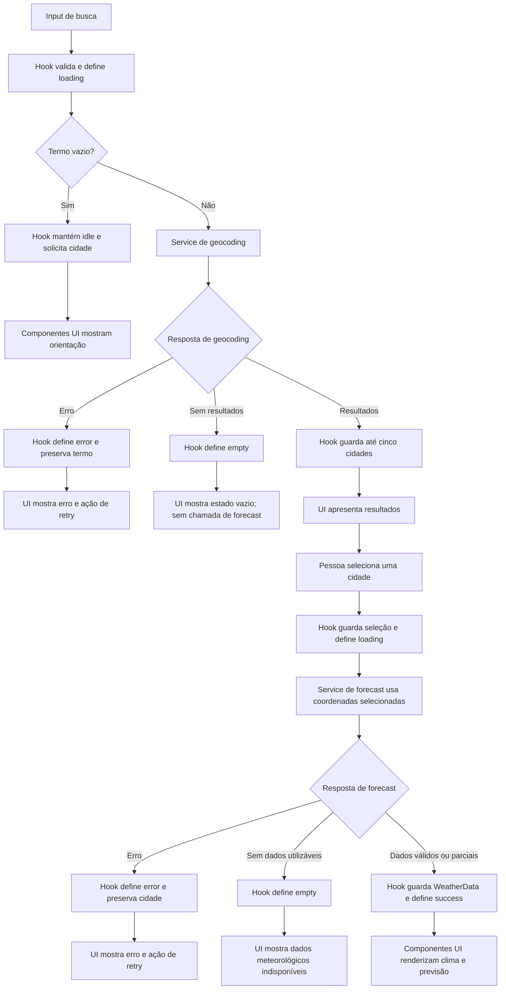

# Plano Técnico — Weather App

Este plano deriva de [`specs/weather-app-spec.md`](../specs/weather-app-spec.md). A spec é a fonte da verdade para o comportamento. Os alvos numéricos identificados nela como propostas continuam sujeitos à validação do responsável pelo produto; a revisão dos termos da Open-Meteo é um gate de release.

## Architecture

Aplicação web client-side, sem backend próprio. Separar o fluxo em quatro camadas com dependências direcionadas para dentro: `components` → `hooks` → `services` → `lib`/`types`. Componentes também podem usar funções de apresentação puras de `lib`; `lib` e `types` não dependem de React, rede ou UI. Não criar abstrações adicionais enquanto este fluxo de busca e consulta não exigir mais complexidade.

- `components` (apresentação): renderizam dados e estados recebidos, emitem ações por callbacks e cuidam de semântica, acessibilidade e interação visual. Não fazem `fetch`, não conhecem URLs/payloads externos e não duplicam regras de conversão.
- `hooks` (orquestração/estado): coordenam busca, seleção, carregamento, erros, cancelamento e atualização do estado da tela. Chamam contratos de `services`, preservam a regra de seleção explícita e não contêm detalhes HTTP ou formatação visual.
- `services` (acesso a dados): encapsulam endpoints, parâmetros, `fetch`, timeout e erros de transporte. Traduzem respostas externas em dados tipados usando mapeadores puros de `lib`; não importam React nem exibem mensagens de UI.
- `lib` (funções puras): concentra conversões de temperatura, formatação de data/hora e condição WMO, além de mapeamento/validação determinística do payload da Open-Meteo. Funções recebem todos os dados por argumento e não têm efeitos colaterais, facilitando testes por entrada/saída.
- `types`: declara contratos internos compartilhados, como `City`, `CurrentWeather`, `ForecastDay`, `WeatherData` e erros de serviço; não implementa comportamento.

Essa divisão permite testar cada camada isoladamente: `lib` com casos de entrada e saída, `services` com `fetch` mockado, hooks com serviços substituídos por mocks e componentes com props/ações controladas. Testes E2E cobrem o fluxo integrado, sem depender da API real.

Não haverá autenticação, backend, cache persistente, armazenamento local, geolocalização nem biblioteca de gerenciamento global de estado na V1.

## Tech Stack

- TypeScript em modo strict.
- React + Vite.
- Tailwind CSS, seguindo o tema dark glassmorphism e os padrões existentes no projeto.
- Open-Meteo Geocoding API e Forecast API, sem API key, sujeitas à validação de termos, atribuição e limites antes do release.
- Vitest + Testing Library para testes unitários/de componentes; Playwright para fluxos E2E.
- pnpm para dependências e scripts; Biome para lint e formatação.

Não adicionar dependências de estado, data fetching ou validação sem necessidade demonstrada: `fetch`, hooks locais e funções puras atendem ao escopo atual.

## Project Structure

Estrutura alvo para `src/`, respeitando as convenções do projeto:

```text
src/
  components/
    SearchForm.tsx
    LocationResults.tsx
    CurrentWeather.tsx
    DailyForecast.tsx
    TemperatureUnitToggle.tsx
  hooks/
    useWeatherSearch.ts
  services/
    openMeteo.ts
  types/
    weather.ts
  lib/
    temperature.ts
    dateTime.ts
    weatherCode.ts
    openMeteoMappers.ts
tests/
  unit/
    lib/
    services/
    hooks/
    components/
  e2e/
```

`openMeteo.ts` contém as chamadas HTTP; `openMeteoMappers.ts` transforma os payloads em contratos internos sem fazer I/O. `temperature.ts`, `dateTime.ts` e `weatherCode.ts` são funções puras reutilizáveis. Os nomes são uma organização inicial, não obrigação de criar um arquivo por contrato: manter a estrutura pequena, adicionar arquivos apenas quando houver responsabilidade distinta e não criar camada genérica de API sem segundo caso de uso.

## Data Model

Tipos internos representam dados normalizados, não o payload externo inteiro. Campos meteorológicos opcionais permanecem ausentes quando a API não os fornece; a UI os apresenta como indisponíveis, nunca como zero ou valor inferido. Temperaturas são mantidas em Celsius e convertidas apenas na apresentação.

```ts
/** Unidade usada para apresentar temperaturas. */
type Unit = 'celsius' | 'fahrenheit';

interface City {
  /** Identificador da cidade retornado pela geocodificação, quando disponível. */
  id?: number;
  /** Nome do local retornado pela geocodificação. */
  name: string;
  /** Latitude usada para consultar a previsão. */
  latitude: number;
  /** Longitude usada para consultar a previsão. */
  longitude: number;
  /** Região administrativa, normalmente o campo admin1. */
  region?: string;
  /** País do local, quando retornado pela geocodificação. */
  country?: string;
  /** Fuso IANA do local, quando retornado pela geocodificação. */
  timezone?: string;
}

interface CurrentWeather {
  /** Temperatura atual em graus Celsius. */
  temperatureC?: number;
  /** Sensação térmica atual em graus Celsius. */
  apparentTemperatureC?: number;
  /** Umidade relativa atual, em porcentagem. */
  relativeHumidityPercent?: number;
  /** Código WMO da condição meteorológica atual. */
  weatherCode?: number;
  /** Horário da observação informado pela API, no fuso retornado. */
  observedAt?: string;
}

interface ForecastDay {
  /** Data local no formato YYYY-MM-DD. */
  date: string;
  /** Código WMO da condição meteorológica do dia. */
  weatherCode?: number;
  /** Temperatura mínima diária em graus Celsius. */
  temperatureMinC?: number;
  /** Temperatura máxima diária em graus Celsius. */
  temperatureMaxC?: number;
  /** Probabilidade máxima diária de precipitação, em porcentagem. */
  precipitationProbabilityMaxPercent?: number;
}

interface WeatherData {
  /** Cidade selecionada para esta consulta. */
  city: City;
  /** Fuso IANA usado pela API para os horários e datas locais. */
  timezone: string;
  /** Condições atuais; ausente se a seção não estiver disponível. */
  current?: CurrentWeather;
  /** Exatamente cinco datas locais; datas sem dados têm apenas date preenchida. */
  forecast: ForecastDay[];
}
```

`weatherCode` é o código WMO fornecido pela API e deve ser convertido para um rótulo pt-BR por uma função explícita; códigos desconhecidos não devem causar falha nem gerar descrição inventada. Datas diárias são strings `YYYY-MM-DD` no calendário local da localização. A UI formata datas como `dd/MM/yyyy` e horários como `HH:mm` (24 horas), conforme FR-07. O horário de observação é o campo `time` da resposta atual; formatá-lo com o fuso de `WeatherData` e não substituí-lo pelo horário da consulta.

A atualidade não é armazenada como outro campo do modelo: derivar na apresentação comparando `observedAt` com a hora atual, no fuso de `WeatherData`. Sinalizar como desatualizado quando a observação tiver mais de 60 minutos, conforme NFR-05; sem `observedAt`, mostrar referência temporal indisponível e não presumir que os dados são atuais.

Contratos de serviço:

```ts
type SearchLocations = (query: string, signal?: AbortSignal) => Promise<City[]>;
type GetWeather = (city: City, signal?: AbortSignal) => Promise<WeatherData>;
```

`SearchLocations` recebe termo já aparado e devolve no máximo cinco itens na ordem da fonte. `GetWeather` usa exatamente as coordenadas da cidade selecionada. Serviços falham com erro tipado descrito em Error Handling, não com mensagens específicas de UI.

## Data Flow

1. A pessoa envia a busca. O app remove espaços das extremidades; entrada vazia não inicia requisição e solicita uma cidade.
2. `SearchLocations` consulta a geocodificação e normaliza os primeiros cinco resultados, preservando acentos e ordem.
3. A UI apresenta nome e detalhes regionais disponíveis. Lista vazia é estado sem resultados, não erro técnico.
4. A pessoa seleciona um resultado explicitamente; apenas então `GetWeather` consulta clima e previsão usando as coordenadas desse resultado.
5. O serviço normaliza os campos atuais e diários. A previsão contém exatamente hoje e os quatro dias locais seguintes, calculados no `timezone` retornado. Se uma data ou seus valores não vierem na resposta, manter a data na lista com os campos meteorológicos ausentes; nunca copiar dados de outro dia.
6. A UI apresenta campos válidos, referência temporal da fonte e indisponibilidades por campo/seção. Resposta nova substitui a anterior; dado retido após falha mantém seu timestamp original e nunca é rotulado como atual sem validação. A idade acima de 60 minutos recebe sinalização de desatualização.
7. A unidade escolhida é estado de sessão em memória. Os valores de origem permanecem em Celsius e a apresentação converte e arredonda ao inteiro mais próximo; recarregar volta a Celsius.



## External APIs

As duas APIs são públicas, sem API key, e devem ser chamadas por HTTPS usando `fetch`. Os exemplos abaixo são resumidos, mas são JSON válido. A estrutura e os campos devem ser confirmados com a documentação vigente ao implementar.

### Geocoding

**URL:** `https://geocoding-api.open-meteo.com/v1/search`

Parâmetros relevantes: `name` recebe o termo aparado e codificado como query string; `count=5` limita resultados; `language=pt` solicita nomes em português quando disponíveis; `format=json` explicita JSON. Exemplo de chamada:

```text
https://geocoding-api.open-meteo.com/v1/search?name=Santiago&count=5&language=pt&format=json
```

Exemplo resumido de resposta:

```json
{
  "results": [
    {
      "id": 3871336,
      "name": "Santiago",
      "latitude": -33.45694,
      "longitude": -70.64827,
      "admin1": "Santiago Metropolitan",
      "country": "Chile",
      "timezone": "America/Santiago"
    }
  ]
}
```

Mapeamento: cada item de `results` vira um `City`: `id`, `name`, `latitude` e `longitude` mantêm os nomes; `admin1` vai para `region`; `country` e `timezone` mantêm os nomes. Campos regionais podem faltar. `results` ausente ou vazio normaliza para lista vazia, não erro técnico; preservar a ordem recebida e limitar novamente a cinco como defesa local.

### Forecast

**URL:** `https://api.open-meteo.com/v1/forecast`

Parâmetros relevantes: `latitude` e `longitude` vêm exatamente do `City` selecionado; `current` solicita condições atuais; `daily` solicita séries diárias; `timezone=auto` faz a API retornar datas/horas no fuso da localização; `forecast_days=5` solicita hoje e os quatro dias seguintes; `temperature_unit=celsius` torna explícita a unidade de origem esperada pelo modelo. Exemplo de chamada (em uma única linha):

```text
https://api.open-meteo.com/v1/forecast?latitude=-33.45694&longitude=-70.64827&current=temperature_2m,apparent_temperature,relative_humidity_2m,weather_code&daily=weather_code,temperature_2m_min,temperature_2m_max,precipitation_probability_max&timezone=auto&forecast_days=5&temperature_unit=celsius
```

Exemplo resumido de resposta (a chamada real solicita cinco dias; o exemplo mostra duas posições para ilustrar o formato):

```json
{
  "timezone": "America/Santiago",
  "current_units": {
    "time": "iso8601",
    "temperature_2m": "°C",
    "apparent_temperature": "°C",
    "relative_humidity_2m": "%",
    "weather_code": "wmo code"
  },
  "current": {
    "time": "2026-05-10T12:00",
    "temperature_2m": 21.4,
    "apparent_temperature": 20.1,
    "relative_humidity_2m": 70,
    "weather_code": 3
  },
  "daily_units": {
    "time": "iso8601",
    "weather_code": "wmo code",
    "temperature_2m_min": "°C",
    "temperature_2m_max": "°C",
    "precipitation_probability_max": "%"
  },
  "daily": {
    "time": ["2026-05-10", "2026-05-11"],
    "weather_code": [3, 2],
    "temperature_2m_min": [12.1, 13.0],
    "temperature_2m_max": [21.4, 22.2],
    "precipitation_probability_max": [10, 20]
  }
}
```

Mapeamento para `WeatherData`: o `City` selecionado entra em `city`; `timezone` da resposta entra em `timezone`. `current.temperature_2m`, `apparent_temperature`, `relative_humidity_2m`, `weather_code` e `time` mapeiam, respectivamente, para `CurrentWeather.temperatureC`, `apparentTemperatureC`, `relativeHumidityPercent`, `weatherCode` e `observedAt`. `daily` usa arrays paralelos: para cada índice `i`, `time[i]` identifica a data e os valores no mesmo índice de `weather_code`, `temperature_2m_min`, `temperature_2m_max` e `precipitation_probability_max` viram os campos correspondentes de `ForecastDay`. Validar comprimentos e associar por data; completar a janela de cinco datas locais no `timezone` da resposta, deixando os campos vazios para uma data ausente ou sem valores. Nunca deslocar valores entre datas nem preencher lacunas com dados de outro dia.

As unidades declaradas em `current_units`/`daily_units` devem ser validadas durante a normalização; temperaturas do modelo permanecem em Celsius e a conversão para Fahrenheit ocorre apenas na apresentação. Usar `daily.time` como data local, sem recalcular o dia no fuso do dispositivo; formatar `current.time` como horário local de 24 horas. `weather_code` é código WMO, não texto: convertê-lo por uma tabela explícita para pt-BR. Campo omitido fica indisponível e não deve ser substituído por zero. HTTP não-OK, JSON inválido e estrutura incompatível são erros tipados. Confirmar atribuição, cobertura, termos e limites de uso antes de publicar; bloquear release se não confirmados.

## State Management

O estado da tela vive em `useWeatherSearch`, chamado pelo componente raiz; não há store global nem persistência. O hook é a fonte única para termo, resultados, cidade selecionada, dados normalizados, unidade e status. Componentes recebem valores e callbacks e não mantêm cópias desses dados. Busca e consulta meteorológica têm status independentes para que o carregamento de uma não mascare a outra.

```ts
type AsyncStatus = 'idle' | 'loading' | 'success' | 'empty' | 'error';

interface WeatherViewState {
  query: string;
  locations: City[];
  selectedCity?: City;
  weather?: WeatherData;
  unit: Unit;
  searchStatus: AsyncStatus;
  weatherStatus: AsyncStatus;
  searchError?: WeatherError;
  weatherError?: WeatherError;
}
```

Significado dos status por fluxo:

- `idle`: ainda não há busca enviada ou cidade selecionada, conforme o fluxo.
- `loading`: requisição daquele fluxo em andamento; encerrar esse estado em toda saída, inclusive erro e timeout.
- `success`: resposta válida com resultados de busca ou dados meteorológicos utilizáveis.
- `empty`: geocodificação válida sem cidades correspondentes; na consulta meteorológica, resposta válida sem nenhum dado utilizável para clima atual ou previsão. Resposta parcial não é `empty`.
- `error`: falha técnica/API; termo e cidade selecionada ficam disponíveis para nova tentativa.

Transições esperadas: busca vazia continua em `idle` e não chama serviço; envio válido passa `searchStatus` para `loading`, depois para `success`, `empty` ou `error`. Selecionar uma cidade passa `weatherStatus` para `loading`, depois para `success`, `empty` ou `error`. Nova tentativa volta a `loading`. Status de busca não altera status meteorológico até uma cidade ser selecionada.

`unit` inicia como `celsius` e vive somente na memória do hook. `WeatherData` guarda temperaturas de origem em Celsius; ao renderizar cada temperatura, componentes usam uma função pura de `lib` para derivar o valor apresentado: para Celsius, arredondar o valor original; para Fahrenheit, calcular `C * 9 / 5 + 32` e arredondar ao inteiro mais próximo. Exibir sempre o sufixo correspondente. A troca de unidade atualiza apenas `unit`: não altera `WeatherData`, não armazena valores convertidos e não inicia novo request. Recarregar reinicia em Celsius.

Ao selecionar outra cidade ou iniciar nova consulta, dados de outra cidade não podem ser apresentados como atuais. Cancelar requisições substituídas com `AbortController` e ignorar resultados tardios (por exemplo, validando o identificador da tentativa) para que respostas antigas não sobrescrevam o estado mais recente.

## Error Handling

Contrato recomendado para erros de serviço:

```ts
type WeatherErrorKind = 'network' | 'api' | 'timeout' | 'invalid-response';

interface WeatherError {
  kind: WeatherErrorKind;
  retryable: boolean;
}
```

Política por classe de falha:

- **Rede:** falha de conexão ou DNS vira `network`; encerrar `loading`, preservar termo/cidade e oferecer nova tentativa.
- **API:** resposta HTTP não-OK ou payload de erro explícito da Open-Meteo vira `api`. Não expor detalhes internos do fornecedor. Permitir nova tentativa sem descartar o contexto da tela.
- **Timeout:** cada request tem limite de 10 s, conforme AC-17/NFR-03. Abortar a requisição, definir `timeout`, encerrar `loading` e oferecer nova tentativa. Uma resposta tardia ou de tentativa anterior é ignorada. A tabela de Edge Cases da spec ainda diz que a duração precisa ser definida; este plano segue o limite explícito de AC-17/NFR-03 e essa redação deve ser reconciliada antes de derivar tarefas.
- **Resposta inválida:** JSON ilegível ou estrutura incompatível com o contrato vira `invalid-response`; não tratar payload malformado como sucesso parcial.
- **Resposta parcial válida:** manter status `success` quando ao menos uma seção/campo meteorológico for utilizável. Renderizar os campos presentes e identificar cada campo ausente como indisponível. Se faltar uma seção inteira, marcá-la indisponível sem ocultar os dados da outra; uma data sem valores continua associada à sua própria data e não recebe dados de outro dia. Se a resposta for estruturalmente válida mas não contiver dado meteorológico utilizável em nenhuma seção, usar `empty`, não `error`.

Forecast retorna clima atual e previsão na mesma chamada. Uma falha de transporte ou HTTP torna a chamada inteira `error`; não simular sucesso de uma seção. Quando a resposta é válida mas parcial, tratar a disponibilidade de cada seção independentemente conforme a regra acima. Ao selecionar outra cidade, remover o relatório anterior para não associá-lo ao novo local; numa nova tentativa para a mesma cidade, qualquer dado anterior que permaneça visível conserva timestamp e sinalização de atualidade originais.

Mensagens pt-BR são definidas na apresentação a partir do tipo de erro, sem acoplar texto de UI ao serviço. Erros terminam o carregamento, preservam o termo/cidade e oferecem nova tentativa. Estados dinâmicos de loading/erro devem ser anunciados por tecnologia assistiva; foco permanece visível e a nova tentativa deve ser operável por teclado.

## Testing Strategy

- **Vitest — funções puras (`lib`):** testar conversão °C/°F, arredondamento e valores negativos/fracionários; formatação pt-BR de datas/horas em fuso informado; mapeamento de códigos WMO; normalizadores de payload com campos opcionais, arrays desalinhados e datas sem valores. Usar relógio e fixtures fixos para validar cinco dias locais consecutivos e o limite de atualidade de 60 minutos.
- **Vitest — serviços (`services`):** substituir `fetch` por mock e verificar URLs/parâmetros, codificação de termos acentuados, coordenadas da cidade selecionada, mapeamento das respostas e limite de cinco resultados. Cobrir geocoding sem resultados, HTTP não-OK, falha de rede, timeout, JSON inválido, payload parcial, cancelamento e resposta tardia; nenhuma suíte depende da Open-Meteo real.
- **Vitest — hooks (`hooks`):** mockar os serviços e testar transições `idle/loading/success/empty/error`, retry, preservação do contexto, seleção explícita, descarte de resposta obsoleta e troca de unidade sem nova chamada de serviço.
- **Vitest + Testing Library — componentes (`components`):** renderizar estados loading, erro, vazio e sucesso; verificar conteúdo pt-BR, temperatura/unidade derivada, indisponibilidade de campos, roles/labels acessíveis, anúncio de estados dinâmicos, foco/teclado e ações de busca, seleção, retry e alternância de unidade.
- **Playwright — E2E:** interceptar as APIs e executar busca → resultados → seleção → clima/previsão, incluindo homônimos, erro/retry, resposta parcial, troca de unidade sem request extra e operação por teclado. Verificar no fluxo que não há persistência em `localStorage`, `sessionStorage` ou cookies e que recarregar limpa a busca/cidade e restaura Celsius. Validar o anúncio dos estados dinâmicos com leitor de tela na matriz de acessibilidade. As fixtures devem ser determinísticas; não usar a API real como dependência do teste.
- **Playwright — mobile:** executar os fluxos principais com viewport de `320 CSS px` (AC-16/NFR-01), verificando que busca, resultados, previsão e alternância de unidade permanecem utilizáveis, sem sobreposição, corte ou rolagem horizontal da página. Incluir nome de cidade longo e validar matriz de navegadores NFR-07 no processo de release.
- **Critérios e gates:** cobrir AC-01 a AC-19 e AC-24 com fixtures de data/fuso; AC-21 verifica observações nos limites de 60 e 61 minutos e timestamp ausente. NFR-03 usa 100 execuções com serviço de teste respondendo em até 500 ms para medir p95; meta de 3 s permanece proposta até aprovação. Para AC-22, monitorar mensalmente a disponibilidade do app (alvo proposto de 99,5%) e registrar separadamente a disponibilidade da Open-Meteo, sem imputar falhas do fornecedor ao app. AC-25 é gate operacional de release dos termos, atribuição, cobertura e limites do fornecedor. Para mudanças em `src/` ou `tests/`, executar `pnpm lint`, `pnpm build` e `pnpm test`.

## Risks & Trade-offs

| Decisão | Trade-off | Alternativas consideradas |
|---|---|---|
| SPA client-side sem backend, chamando Open-Meteo diretamente por HTTPS | Menos infraestrutura e sem credenciais próprias; a disponibilidade/limites do fornecedor impactam consultas e a política de retry fica no cliente. | Proxy/backend daria controle de cache, rate limit e observabilidade, mas adicionaria custo e operação sem requisito que justifique isso na V1. Reavaliar apenas se os termos ou limites do fornecedor exigirem. |
| Estado local em `useWeatherSearch`, sem store global | Simples e suficiente para uma tela/fluxo; estado não é compartilhado entre rotas nem sobrevive ao reload. | Redux/Zustand ou Context central poderiam atender múltiplas telas e estado compartilhado, mas aumentariam dependências e superfície sem benefício atual. |
| Um request Forecast para clima atual e previsão | Uma chamada reduz coordenação e latência; falha de transporte afeta o payload inteiro, embora seções válidas de uma resposta parcial sejam renderizadas separadamente. | Separar current e forecast permitiria sucesso independente, mas duplica requests e estados; não é necessário para o contrato atual. |
| Celsius como unidade canônica; Fahrenheit derivado na apresentação | Dados são consistentes e alternar unidade não exige request nem mutação; conversão e arredondamento são responsabilidade local testável. | Solicitar Fahrenheit à API ou guardar valores convertidos duplicaria estados e poderia exigir nova chamada; não atende melhor ao escopo. |
| Sem persistência local e sem cache na V1 | Cumpre NFR-08 e evita retenção de cidade/preferência; preferências e dados são perdidos ao recarregar e não há uso offline. | `localStorage`, `sessionStorage` ou cache melhorariam conveniência/resiliência, mas conflitam com a decisão explícita de não persistir no dispositivo. |
| Mocks determinísticos em Vitest/Playwright | Testes reproduzíveis e independentes de rede, cobertura e disponibilidade do fornecedor; não detectam sozinhos mudanças reais de contrato da API. | Testar contra API real em toda execução tornaria a suíte instável e dependente de rede. Verificação de termos/contrato fica como gate de release, com eventual smoke test controlado fora da suíte obrigatória. |
| Dependência e contrato da Open-Meteo isolados em `services`/mapeadores | Mudanças no payload ficam contidas e testáveis; exige manter fixtures e validar documentação atual. | Espalhar `fetch` pelos componentes/hooks reduziria arquivos inicialmente, mas acoplaria UI ao fornecedor e dificultaria substituição e testes. |

## Requirement Traceability

| Requisitos da spec | Decisões/seções do plano |
|---|---|
| FR-01, FR-02 | Geocoding, `City`, Data Flow, estados de busca e testes de busca/seleção. |
| FR-03, FR-04 | `CurrentWeather`, `ForecastDay`, Forecast API, normalização por data e estados parciais. |
| FR-05 | `Unit`, Celsius canônico, conversão derivada na renderização e testes sem novo request. |
| FR-06 | `City`/`WeatherData`, `timezone`, `observedAt` e sinalização de dados acima de 60 minutos. |
| FR-07 | Formatação pt-BR `dd/MM/yyyy`/`HH:mm`, rótulos WMO e testes de conteúdo acessível. |
| FR-08 | SPA sem autenticação; testes E2E do fluxo sem conta. |
| NFR-01, NFR-02 | Componentes acessíveis, testes de teclado/leitor de tela e Playwright em 320 CSS px. |
| NFR-03, NFR-04 | Timeout, erros/retry, testes determinísticos e medição de p95 proposta. |
| NFR-05 | Timestamp da fonte e teste dos limites de 60/61 minutos. |
| NFR-06 | Monitoramento mensal separado para app e fornecedor; alvo de 99,5% permanece proposta. |
| NFR-07 | Matriz de navegadores definida na estratégia de testes/release. |
| NFR-08 | Sem geolocalização ou persistência; validação por reload e inspeção de armazenamento no E2E. |
| NFR-09 | Validação de termos, atribuição, cobertura e limites como gate de release. |

US-05 não acrescenta campos à V1: a spec declara indefinidos os dados necessários para planejamento de atividade; ampliar esse caso exige decisão de produto e atualização da spec.